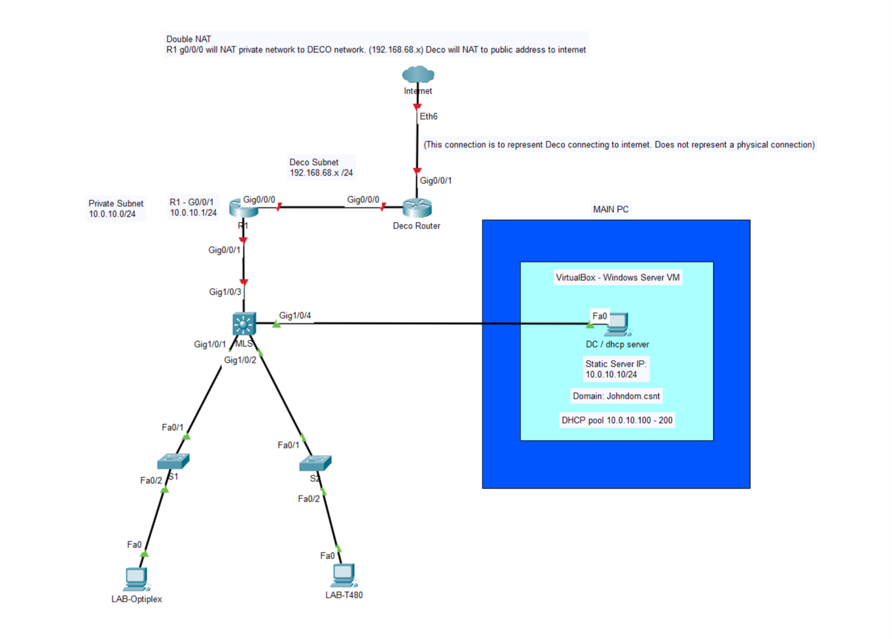
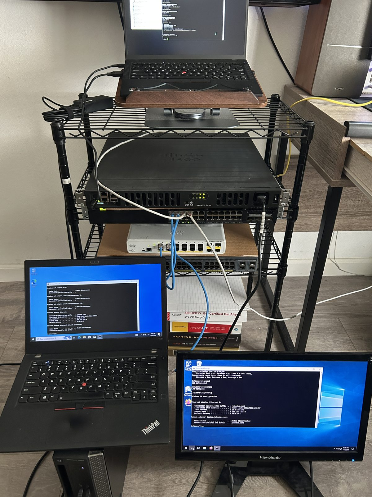

# Enterprise-Style Home Network Lab

A hands-on networking and Windows Server lab built from real Cisco hardware, used to practice what I'm studying and to build skills for a networking role.

> **Status:** Phase 1 complete (flat network, Day 1: 2 Nov 2026).

## Day 1 result

A flat network where a Windows Server domain controller hands out DHCP leases, domain-joined clients sit on different physical switches, and everything reaches the internet through a Cisco router.

This is my first time building this, so it's a double NAT setup: R1 NATs my private subnet (10.0.10.0/24) to the Deco router network (192.168.68.x/24), then the Deco router NATs its private network to the public address from my internet provider.





| Component | Role | Address |
|---|---|---|
| Cisco ISR4331 (R1) | Gateway + NAT. WAN `Gi0/0/0` takes DHCP from my home Deco 6E, LAN `Gi0/0/1` faces the lab | `10.0.10.1/24` |
| Catalyst 3650 (multilayer switch) | Core switch | n/a |
| Catalyst 2960-X / 2960-C | Access switches | n/a |
| `dc01` (Windows Server VM on my main PC, VirtualBox) | Active Directory, DNS, DHCP for `johndom.csnt` | `10.0.10.10` |
| `LAB-T480` (ThinkPad T480, Windows) | Domain-joined client | `10.0.10.101` (DHCP) |
| `LAB-OPTIPLEX` (Dell OptiPlex 3020, Windows) | Domain-joined client | `10.0.10.102` (DHCP) |

Network: `10.0.10.0/24` · DHCP pool `10.0.10.100–200` · domain `johndom.csnt`

## What I built and verified

- Cisco ISR4331 with NAT overload so the whole lab shares one upstream address ([config](configs/R1-isr4331-day1.cfg))
- Windows Server running **AD DS, DNS and DHCP**
- DHCP scope options: router `10.0.10.1`, DNS `10.0.10.10`, domain `johndom.csnt` ([screenshot](images/screenshots/dhcp-scope-options.png))
- Two clients on separate switches joined to the domain ([screenshot](images/screenshots/ad-computers-joined.png)) and holding leases from the DC ([screenshot](images/screenshots/dhcp-address-leases.png))
- End-to-end test: `ping 8.8.8.8` from the router and from a domain client both succeed

## Roadmap

- [x] Phase 1: flat network, router NAT, AD + DNS + DHCP, domain-joined clients
- [ ] Phase 2: VLANs, trunks, inter-VLAN routing on the multilayer switch
- [ ] Phase 3: firewall VM (pfSense/OPNsense), ACLs, move NAT/policy to it
- [ ] Phase 4: hardening (SSH only, enable secret, port security, DHCP snooping), Group Policy, file shares
- [ ] Phase 5: monitoring and logging (syslog, SNMP)

## Repo layout

```
configs/    device configs
diagrams/   Day 1 topology (image + Packet Tracer file)
docs/       build logs, one per phase/day
images/     photos and screenshots used in the docs
```

## Skills practiced

Cisco IOS (routing, NAT, ACLs) · IP addressing & subnetting · Windows Server (AD DS, DNS, DHCP) · domain joins · VirtualBox networking · structured cabling (hand-made Ethernet) · troubleshooting with `ping`, `ipconfig`, `show` commands · documentation
