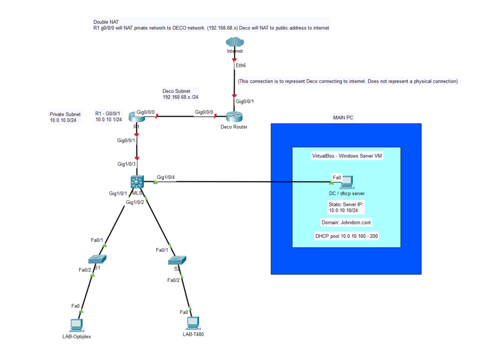
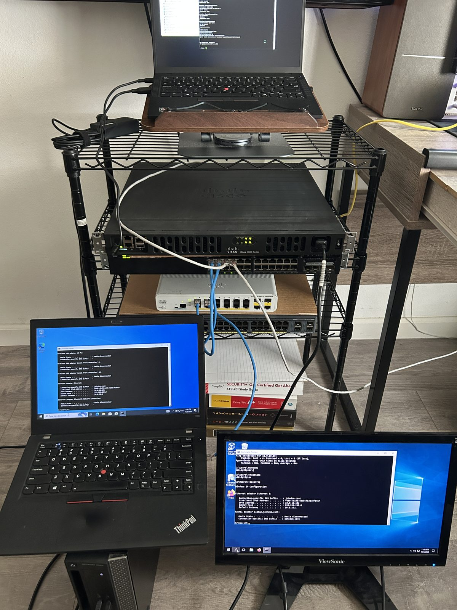

# Day 1: Flat Network with AD and DHCP

**Date:** 2 Nov 2026

> Disclaimer [main README](../README.md)

> **Status:** Phase 1 complete (flat network). Day 2 split this into VLANs, see [Day 2](../day2/README.md). Step-by-step notes: [Day 1 build log](../docs/day1-build-log.md).

## Main idea

A flat network where a Windows Server domain controller hands out DHCP leases, domain-joined clients sit on different physical switches, and everything reaches the internet through a Cisco router.

## My thoughts

This was my first time configuring NAT to reach the internet, and for some reason the idea felt intimidating. My understanding of NAT was that the edge router would NAT the private network straight to the ISP's public network, assuming the ISP provided a public IP. What I learned is that I didn't have to worry about the public side at all. Instead, I could configured NAT on R1 to translate traffic to the Deco router's network, and the Deco then performs NAT again on its way out to the internet. This is called double NAT, and seeing it work was a great learning moment. I assume double NAT isn't ideal for professional networks, but it works well for my home lab.

| Component | Role | Address |
|---|---|---|
| Cisco ISR4331 (R1) | Gateway + NAT. WAN `Gi0/0/0` takes DHCP from my home Deco 6E, LAN `Gi0/0/1` faces the lab | `10.0.10.1/24` (changed in Day 2) |
| Catalyst 3650 (multilayer switch) | Core switch | n/a |
| Catalyst 2960-X / 2960-C | Access switches | n/a |
| `dc01` (Windows Server VM on my main PC, VirtualBox) | Active Directory, DNS, DHCP for `johndom.csnt` | `10.0.10.10` |
| `LAB-T480` (ThinkPad T480, Windows) | Domain-joined client | `10.0.10.101` (DHCP) |
| `LAB-OPTIPLEX` (Dell OptiPlex 3020, Windows) | Domain-joined client | `10.0.10.102` (DHCP) |

Network: `10.0.10.0/24` · DHCP pool `10.0.10.100–200` · domain `johndom.csnt`

## What I built and verified

- Cisco ISR4331 with NAT overload so the whole lab shares one upstream address ([config](../configs/R1-isr4331-day1.cfg))
- Windows Server running **AD DS, DNS and DHCP**
- DHCP scope options: router `10.0.10.1`, DNS `10.0.10.10`, domain `johndom.csnt` ([screenshot](../images/screenshots/dhcp-scope-options.png))
- Two clients on separate switches joined to the domain ([screenshot](../images/screenshots/ad-computers-joined.png)) and holding leases from the DC ([screenshot](../images/screenshots/dhcp-address-leases.png))
- End-to-end test: `ping 8.8.8.8` from the router and from a domain client both succeed
