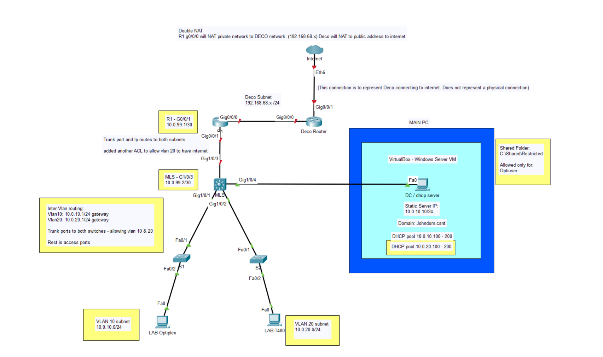
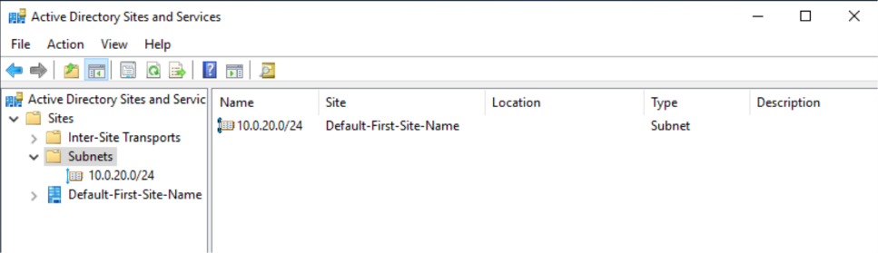
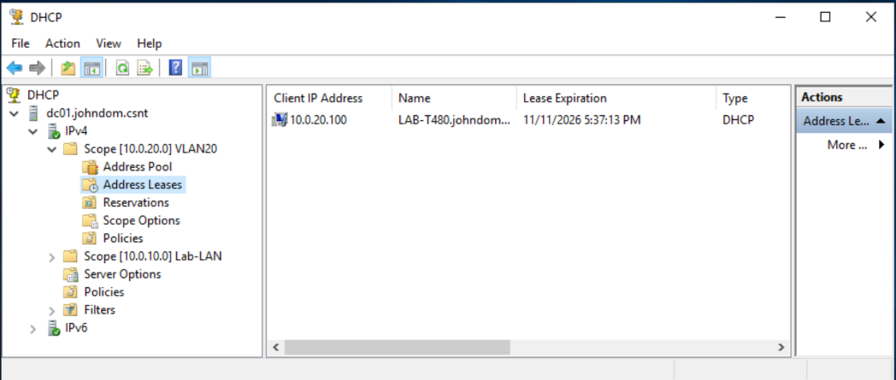
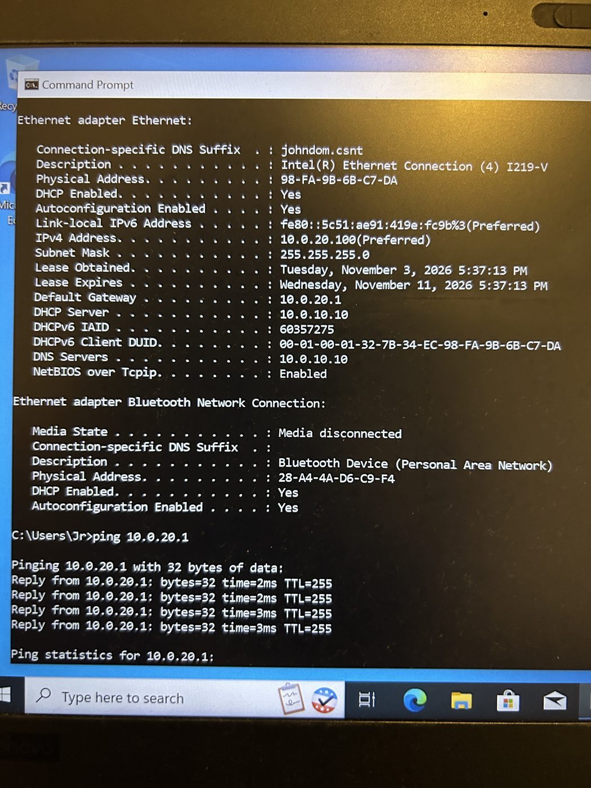
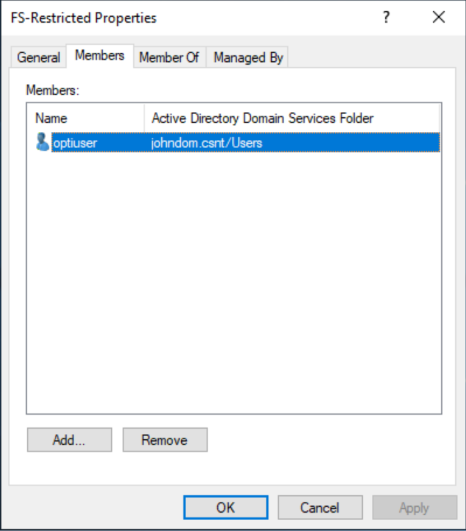
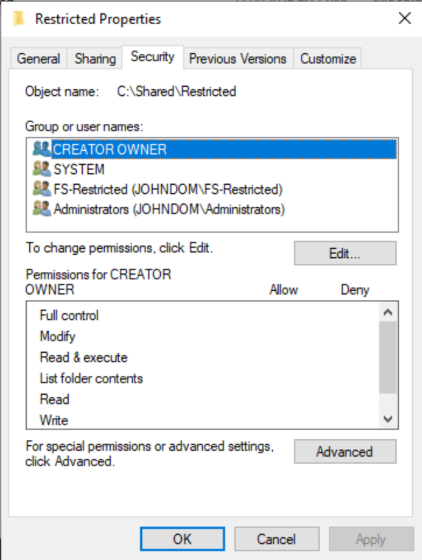
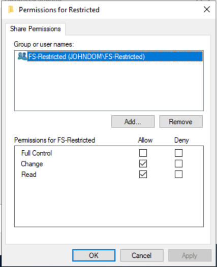
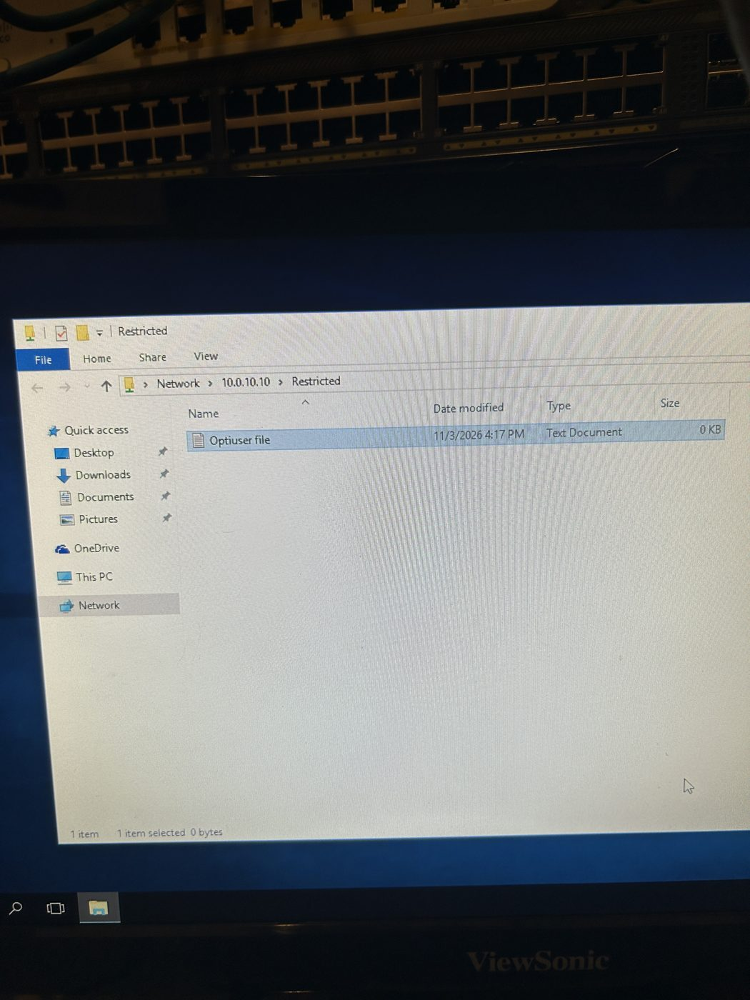
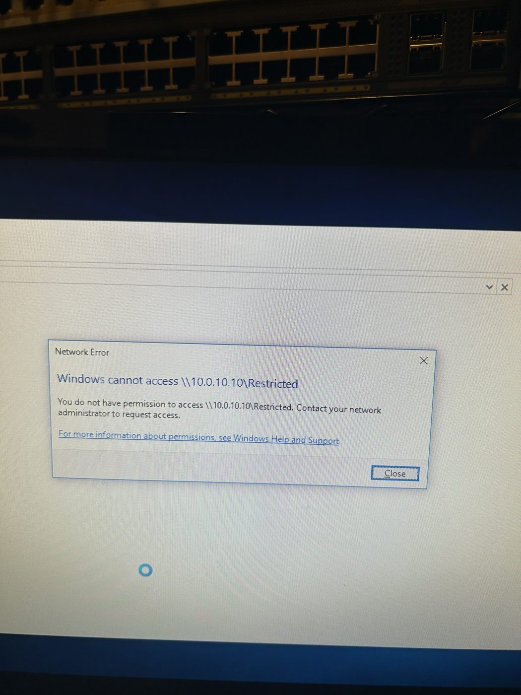

# Day 2: VLANs, Inter-VLAN Routing and a Restricted File Share

**Date:** 3 Nov 2026  **Goal:** split the flat Day 1 network into two VLANs, route between them on the multilayer switch, give VLAN 20 its own DHCP scope, and lock a shared folder down to one user.

> Same disclaimer as the [main README](../README.md): I used AI assistance while building and writing this up, I'm still learning, and my setup may not match how professionals would do it. Feedback is welcome.

> **Status:** Phase 2 (VLANs, trunks, inter-VLAN routing). Part of Phase 4 (file shares) started early.

[Day 1 build log](../docs/day1-build-log.md) covers the flat network this builds on.

## Main idea

Day 1 was one flat `10.0.10.0/24`, with R1 as the gateway. For Day 2 the multilayer switch (MLS) takes over as the gateway for two VLANs, R1 becomes a routed hop to the internet, and the DC's DHCP service hands out leases to both VLANs through a DHCP relay.



> The port labels in this diagram are Packet Tracer's interfaces, so they don't match the real hardware ports. The real port map is in the table below. Packet Tracer file: [`day2-topology.pkt`](../diagrams/day2-topology.pkt).

## Addressing

| Network | Subnet | Gateway | Who is on it |
|---|---|---|---|
| VLAN 10 | `10.0.10.0/24` | `10.0.10.1` (MLS SVI) | DC (`10.0.10.10`), OptiPlex |
| VLAN 20 | `10.0.20.0/24` | `10.0.20.1` (MLS SVI) | T480 |
| Routed link MLS to R1 | `10.0.99.0/30` | R1 `.1`, MLS `.2` | n/a |

DHCP pools: VLAN 10 `10.0.10.100–200`, VLAN 20 `10.0.20.100–200`. Domain `johndom.csnt`.

## Physical port map

| Link | Port A | Port B | Mode |
|---|---|---|---|
| MLS to S1 | MLS `Gi1/0/1` | S1 `Gi1/0/1` | Trunk, VLANs 10 and 20 |
| MLS to S2 | MLS `Gi1/0/3` | S2 `Fa0/1` | Trunk, VLANs 10 and 20 |
| MLS to R1 | MLS `Gi1/0/5` | R1 `Gi0/0/1` | Routed (`no switchport`), `10.0.99.2/30` |
| MLS to main PC (DC VM) | MLS `Gi1/0/7` | VirtualBox bridged NIC | Access, VLAN 10 |
| S1 to OptiPlex | S1 `Gi1/0/3` | OptiPlex | Access, VLAN 10 |
| S2 to T480 | S2 `Fa0/3` | T480 | Access, VLAN 20 |

## Design decisions

- **Keep VLAN 10 as the old Day 1 subnet.** The DC (`10.0.10.10`) and its DHCP scope didn't have to change. Only the T480 moved to a new subnet.
- **The gateway moved from R1 to the MLS.** The MLS now owns `10.0.10.1` and `10.0.20.1` as SVIs. R1 only needs a `/30` link to the MLS plus return routes.
- **DHCP relay instead of a second DHCP server.** DHCP broadcasts don't cross VLANs, so `ip helper-address 10.0.10.10` on the VLAN 20 SVI forwards requests to the DC. The DC picks the right scope from the subnet the request came from.
- **Restrict the share with AD permissions, not with an ACL.** The share is on the DC, and the DC also serves domain logins and Group Policy.

## Steps

### 1. Prep
Renamed the devices (`R1`, `MLS`, `S1`, `S2`). The generic default names confused me on Day 1. The MLS had a leftover ACL from earlier practice, so I wiped it (see lessons below).

### 2. VLANs and trunks (Layer 2)
Created VLANs 10 and 20 on all three switches, trunked the MLS to both access switches, and assigned the host ports. Excerpt from the MLS ([full config](../configs/MLS-3650-day2.cfg)):

```
interface GigabitEthernet1/0/1
 description TRUNK to S1
 switchport trunk allowed vlan 10,20
 switchport mode trunk
interface GigabitEthernet1/0/3
 description TRUNK to S2
 switchport trunk allowed vlan 10,20
 switchport mode trunk
interface GigabitEthernet1/0/7
 description MAIN PC / DC
 switchport access vlan 10
 switchport mode access
```

At this point I temporarily left the R1 port in VLAN 10 so the OptiPlex and DC kept working while I tested the trunks.

### 3. Inter-VLAN routing (Layer 3)
R1 changed first, because R1 and the MLS can't both own `10.0.10.1`:

```
interface GigabitEthernet0/0/1
 description LAN to MLS
 ip address 10.0.99.1 255.255.255.252
ip route 10.0.10.0 255.255.255.0 10.0.99.2
ip route 10.0.20.0 255.255.255.0 10.0.99.2
ip access-list standard 1
 10 permit 10.0.10.0 0.0.0.255
 20 permit 10.0.20.0 0.0.0.255
```

The second ACL line matters. Without it, NAT ignores VLAN 20 and it can't reach the internet. Then the MLS:

```
ip routing
interface GigabitEthernet1/0/5
 description Routed link to R1
 no switchport
 ip address 10.0.99.2 255.255.255.252
interface Vlan10
 ip address 10.0.10.1 255.255.255.0
interface Vlan20
 ip address 10.0.20.1 255.255.255.0
 ip helper-address 10.0.10.10
ip route 0.0.0.0 0.0.0.0 10.0.99.1
```

Full configs: [R1](../configs/R1-isr4331-day2.cfg), [MLS](../configs/MLS-3650-day2.cfg), [S1](../configs/S1-2960x-day2.cfg), [S2](../configs/S2-2960c-day2.cfg).

### 4. DHCP for VLAN 20
On the DC, I created a second scope, `10.0.20.0` "VLAN20", pool `.100–.200`, with router `10.0.20.1` and DNS `10.0.10.10`. I also added `10.0.20.0/24` to AD Sites and Services so VLAN 20 clients map to the right site.




The T480 received `10.0.20.100`. In the output below, the **DHCP Server is `10.0.10.10`**, which is on a different subnet. That is the relay working.



### 5. Restricted shared folder
Created `C:\Shared\Restricted` on the DC. Created a security group `FS-Restricted` with only `optiuser` in it, plus `otheruser`, who is not in the group.



NTFS: inheritance disabled, `Users` removed, `FS-Restricted` added. Share permissions: `Everyone` removed, `FS-Restricted` given Change.




Test results (photos of the client screens):

- `optiuser` on the OptiPlex opened `\\10.0.10.10\Restricted` and created a file.
- `otheruser` on the T480 got "You do not have permission to access".




## What I built and verified

- VLANs 10 and 20 on three switches, with 802.1Q trunks to the MLS
- Inter-VLAN routing on the MLS, with a routed `/30` link to R1 and updated NAT and routes
- DHCP relay: the T480 in VLAN 20 got a lease from the DC in VLAN 10
- OptiPlex (VLAN 10) and T480 (VLAN 20) both reach the gateway, the DC and the internet
- A shared folder that only members of `FS-Restricted` can open

## Problems and lessons

- **`write erase` didn't remove the leftover ACL.** Had to manually remove previous ACLs
- **A plain ping from the MLS to `8.8.8.8` failed even though routing was fine.** It uses the exit interface address (`10.0.99.2`) as the source, which isn't in R1's NAT ACL. Pinging with `source vlan 10` or `source vlan 20` tests what clients actually experience.
- **The domain's password policy blocked creating my test user.** I had to relax the password policy for lab use before the account would create.

## Files for Day 2

```
day2/README.md                 this file
configs/*-day2.cfg             sanitized running configs (R1, MLS, S1, S2)
diagrams/day2-topology.png     topology (and the .pkt Packet Tracer file)
images/screenshots/day2-*      screenshots and photos used above
```
