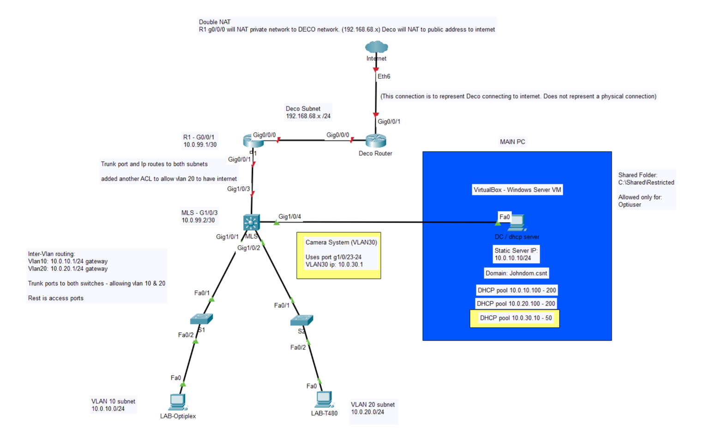
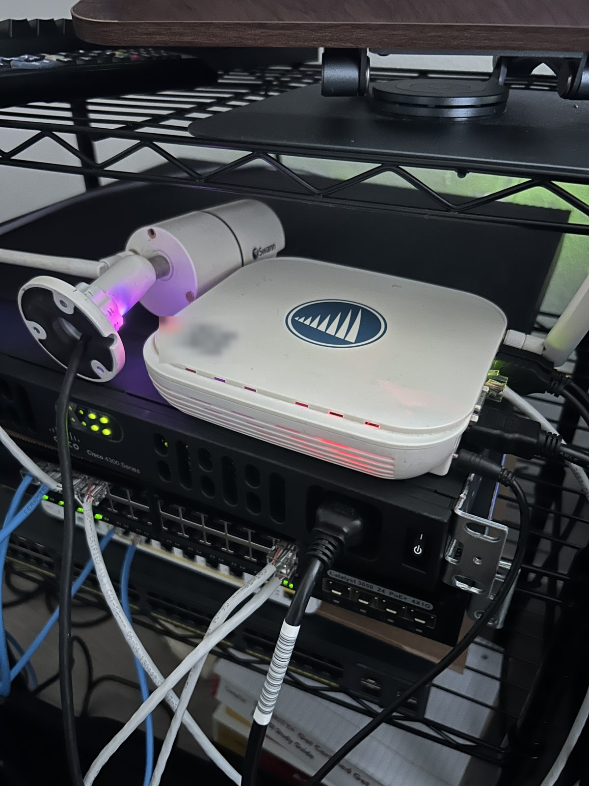
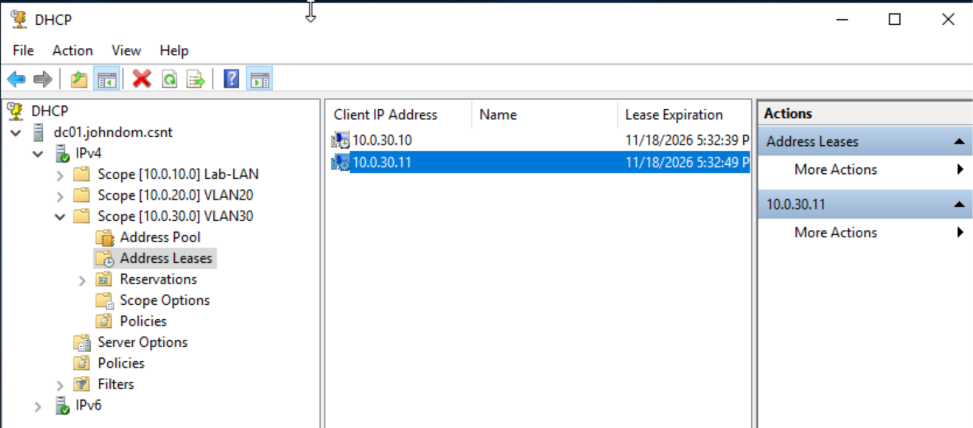
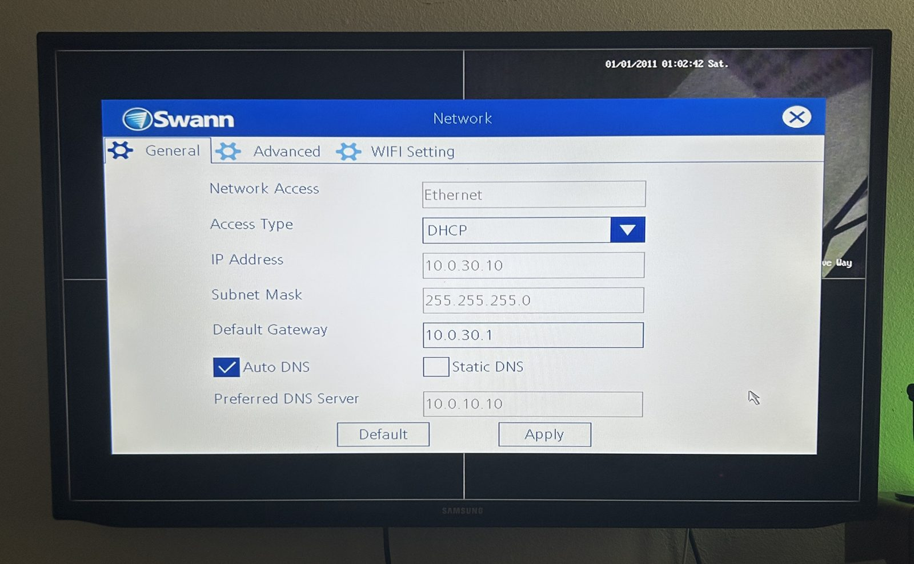
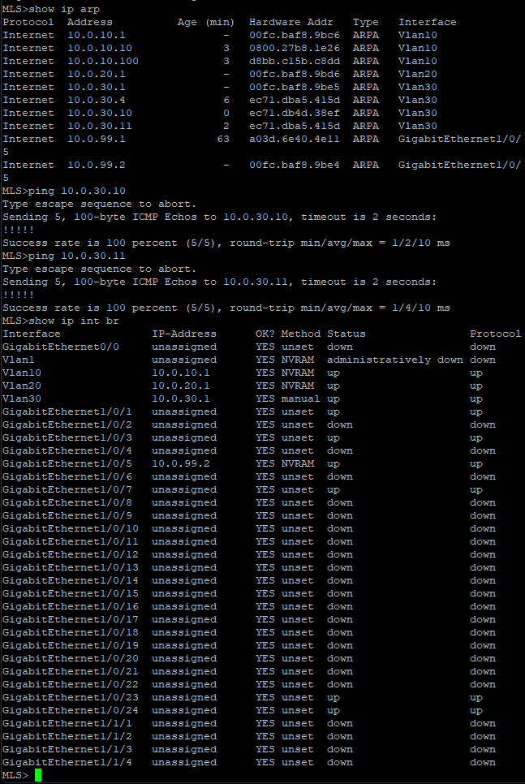
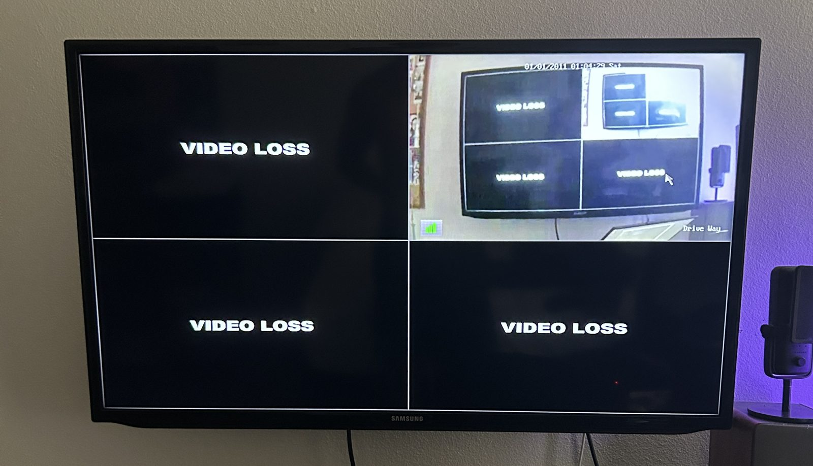
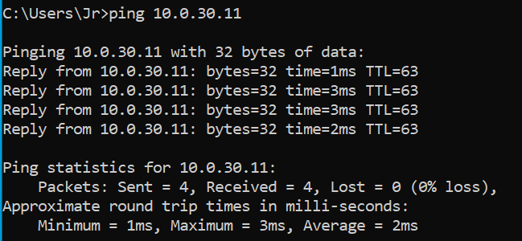
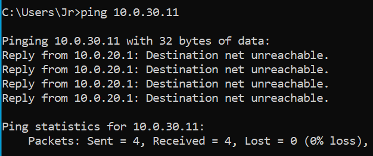
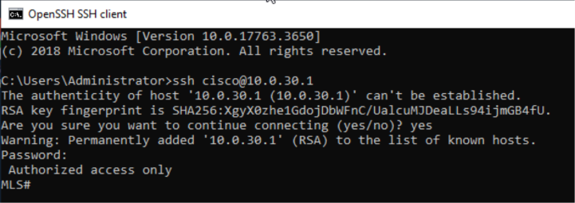

# Day 3: Security VLAN for the Swann NVR and Camera, ACL Isolation and Switch Hardening

**Date:** 10 Nov 2026 

**Goal:** Put my Swann NVR and camera on their own VLAN with DHCP from the DC, isolate them from the rest of the lab with ACLs in both directions, and start hardening the multilayer switch (SSH only, unused ports shut down).

> Disclaimer: see the [main README](../README.md).

> **Status:** Phase 3 (ACLs) and part of Phase 4 (hardening). 

[Day 2 write-up](../day2/README.md) covers the VLANs and DHCP relay this builds on.

## Main idea

Adds VLAN 30 for security cameras. The MLS is the gateway, the DC hands out the addresses with DHCP, and two ACLs on the VLAN 30 interface keep the cameras away from the rest of the lab.



> The port labels in this diagram are Packet Tracer's interfaces, so they don't match the real hardware ports. The new links are in the port map below. Packet Tracer file: [`day3-topology.pkt`](../diagrams/day3-topology.pkt).

## Thoughts

I was gifted an old camera system, so I decided to add it to the lab and simulate a security office that is isolated from the rest of the network. It was my first time doing this, and I’m glad I got it to work. It was a bit difficult figuring out the camera system and getting into the account. I got lucky and guessed the admin password, otherwise this wouldn’t have worked. I also had a confusing time figuring out if the camera was receiving DHCP, because the ports kept showing “unassigned” instead of an IP. After I got that working, I added ACLs to isolate VLAN 30, the security office. This blocks the camera system from reaching my other VLANs, and blocks my other VLANs from reaching it. DHCP is still allowed so the camera can receive an IP. Lastly, I added SSH, set a secret password, and shut down the unused ports. 



## Addressing

| Network | Subnet | Gateway | Who is on it |
|---|---|---|---|
| VLAN 30 | `10.0.30.0/24` | `10.0.30.1` (MLS SVI) | Swann NVR (`10.0.30.10`), camera (`10.0.30.11`) |

DHCP pool for VLAN 30: `10.0.30.10–50`.

## Physical port map (new links)

| Link | Port A | Port B | Mode |
|---|---|---|---|
| MLS to Swann NVR and camera | MLS `Gi1/0/23` and `Gi1/0/24` | NVR and camera Ethernet ports | Access, VLAN 30 |

## Design decisions

- **Own VLAN for the cameras.** I don't want them near the DC or my PCs, so they get their own subnet that I can control with ACLs.
- **No trunk changes.** The NVR and camera plug straight into the MLS, so VLAN 30 never crosses a trunk. The trunks to S1 and S2 still only carry VLANs 10 and 20.
- **Same DHCP relay as VLAN 20.** `ip helper-address 10.0.10.10` on the VLAN 30 interface sends requests to the DC.
- **Two ACLs on the VLAN 30 interface.** One covers traffic coming from the cameras and the other covers traffic going to them. Both are applied at VLAN 30's gateway.

## Steps

### 1. VLAN 30 gateway and camera ports

MLS ([full config](../configs/MLS-3650-day3.cfg)):

```
interface GigabitEthernet1/0/23
 switchport access vlan 30
 switchport mode access
interface GigabitEthernet1/0/24
 switchport access vlan 30
 switchport mode access
interface Vlan30
 ip address 10.0.30.1 255.255.255.0
 ip helper-address 10.0.10.10
```

### 2. DHCP scope for VLAN 30

On the DC I created a scope `10.0.30.0` named "VLAN30", pool `.10–.50`, with router `10.0.30.1`. The NVR got `10.0.30.10` and the camera got `10.0.30.11`.



The NVR's own network page shows what it picked up: DHCP, `255.255.255.0`, gateway `10.0.30.1`, and the DC (`10.0.10.10`) as DNS.



### 3. Checking from the MLS

`show ip arp` lists both devices, both pings from the MLS worked, and `show ip interface brief` shows `Vlan30` up with `10.0.30.1` and `Gi1/0/23` and `Gi1/0/24` up.



The NVR's live view on the TV works too. The top-right channel is the camera and the other channels have no camera.



### 4. ACLs

```
ip access-list extended VLAN30-IN
 permit udp any eq bootpc any eq bootps
 deny   ip 10.0.30.0 0.0.0.255 10.0.0.0 0.255.255.255
 deny   ip 10.0.30.0 0.0.0.255 192.168.0.0 0.0.255.255
 permit ip any any
ip access-list extended VLAN30-OUT
 deny   ip 10.0.10.0 0.0.0.255 10.0.30.0 0.0.0.255
 deny   ip 10.0.20.0 0.0.0.255 10.0.30.0 0.0.0.255
 permit ip any any
interface Vlan30
 ip access-group VLAN30-IN in
 ip access-group VLAN30-OUT out
```

**`VLAN30-IN`** filters traffic coming from the NVR and camera:
1. Lets DHCP requests through (client port 68 to server port 67).
2. Blocks them from reaching any `10.x.x.x` network.
3. Blocks them from reaching `192.168.x.x`, which is my home Deco network.
4. Allows everything else.

**`VLAN30-OUT`** filters traffic going to the cameras. It blocks VLAN 10 and VLAN 20 from reaching VLAN 30.


### 5. Testing the ACLs

From the T480 (VLAN 20), I pinged the camera before and after applying the ACLs. 




### 6. Hardening the MLS

- SSH version 2
- A local user and an enable secret (hashes are removed).
- `service password-encryption` and a login banner.
- Every unused access port shut down: `Gi1/0/2`, `4`, `6` and `8–22`.

```
ip domain-name johndom.csnt
ip ssh version 2
username cisco privilege 15 secret <redacted>
enable secret <redacted>
banner motd ^C Authorized access only ^C
line vty 0 4
 login local
 transport input ssh
line vty 5 15
 login local
 transport input ssh
```

I tested SSH from the Windows Server before closing my console session.



## What I built and verified

- VLAN 30 with the MLS as its gateway, and a DHCP scope on the DC reached through the relay
- The NVR (`10.0.30.10`) and camera (`10.0.30.11`) got leases and answer pings from the MLS
- ACLs in both directions on the VLAN 30 interface. A client in VLAN 20 can no longer reach the camera
- SSH-only management of the MLS and all unused access ports shut down

## Problems and lessons

- **I thought VLAN 30 had to be allowed on the trunks.** It doesn't. The cameras plug directly into the MLS and the MLS routes between VLANs, so only VLANs that have devices behind a trunk need to be on it.
- **Physical ports show "unassigned" in `show ip interface brief`.** That is normal for Layer 2 ports. Only the VLAN interface has an IP.
- **The NVR didn't answer pings from other VLANs, but the camera did.** The NVR's mask and gateway were correct, and the camera replied through the same routing, so the network path was fine. 
- **Test from a client, not the switch.** Traffic the switch creates itself skips an outbound ACL, so a ping from the MLS can succeed even when the ACL is working.


## Still to do

- Possibly give VLAN 30 access to the internet
- Set up DNS for VLAN 30
- Update the ACLs to match

## Files for Day 3

```
day3/README.md                 this file
configs/MLS-3650-day3.cfg      sanitized MLS running config (password hashes removed)
images/day3/day3-*             screenshots and photos used above
```
