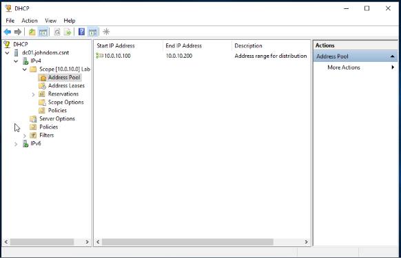
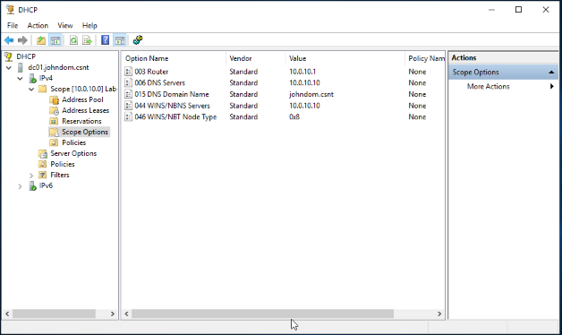
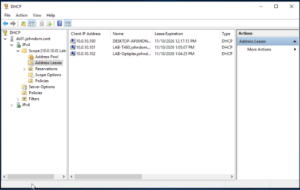
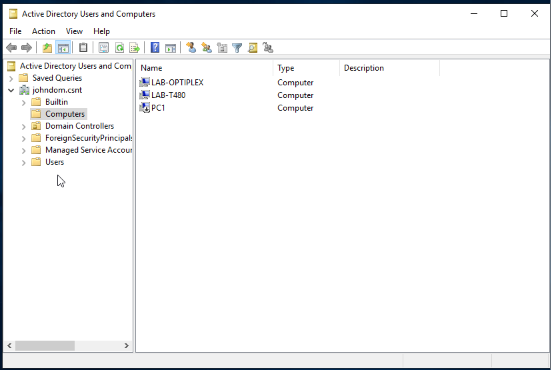
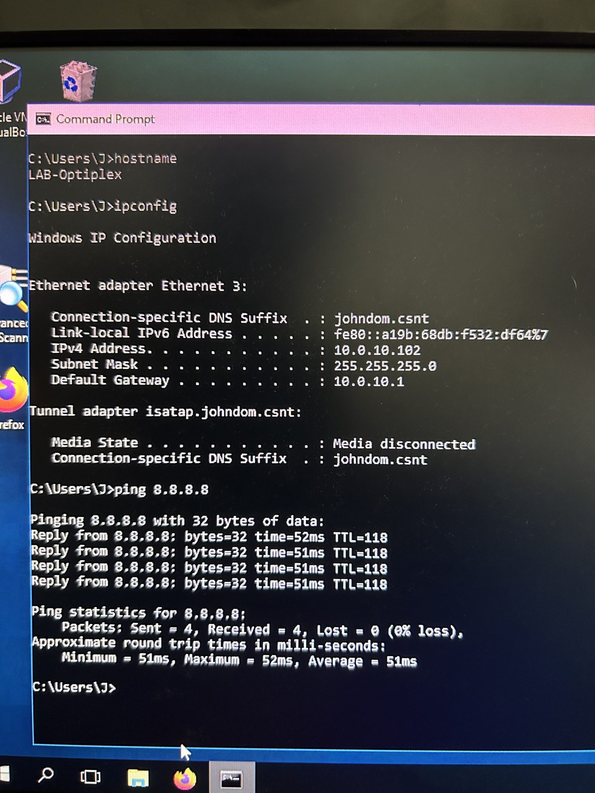

# Day 1 Build Log: Flat network with AD, DNS and DHCP

**Date:** 2 Nov 2026  **Goal:** get every device talking and online on one simple network before adding VLANs.

## Design decisions

- **One flat `/24` first.** Fewer moving parts to troubleshoot. VLANs and inter-VLAN routing come in Phase 2.
- **The lab is isolated in my room.** The home Deco 6E only provides the internet uplink; it does **not** hand out DHCP to lab devices.
- **Domain controller is a VM on my main PC** (VirtualBox).
- **DHCP:** the Windows Server runs DHCP, so I control scopes and options.

## Addressing

| Item | Value |
|---|---|
| Lab subnet | `10.0.10.0/24` |
| Gateway (R1 `Gi0/0/1`) | `10.0.10.1` |
| DC / DNS | `10.0.10.10` |
| DHCP pool | `10.0.10.100 – 10.0.10.200` |
| Domain | `johndom.csnt` |
| R1 WAN | DHCP from Deco 6E |

## Steps

### 1. Cabling
Cables are hand made - straight through - cat 5e ethernet cables.

Connect: Deco 6E → R1 `Gi0/0/0`; R1 `Gi0/0/1` → multilayer switch; switches → clients (one client on each of 2 switches).


### 2. Router (ISR4331)
Configured WAN as a DHCP client. The Deco 6e router gives an address to interface g0/0/0.

Configured LAN as static address `10.0.10.1/24`, and NAT overload so lab traffic leaves with the router's WAN address:

```
interface GigabitEthernet0/0/0
 description WAN to Deco
 ip address dhcp
 ip nat outside
interface GigabitEthernet0/0/1
 description LAN to MLS
 ip address 10.0.10.1 255.255.255.0
 ip nat inside
!
ip access-list standard 1
 permit 10.0.10.0 0.0.0.255
ip nat inside source list 1 interface GigabitEthernet0/0/0 overload
```
Verified: `ping 8.8.8.8` from the router → 5/5.

Full config: [`configs/R1-isr4331-day1.cfg`](../configs/R1-isr4331-day1.cfg).

### 3. Domain controller
Windows Server VM, static IP `10.0.10.10`. Installed AD DS (promoted to a new forest `johndom.csnt`), DNS, and DHCP.


### 4. DHCP scope
Scope `10.0.10.0` "Lab", pool `.100–.200`, options 003 router `10.0.10.1`, 006 DNS `10.0.10.10`, 015 domain `johndom.csnt`.




### 5. Clients and domain join
T480 and OptiPlex pulled leases (`.101`, `.102`) and were joined to `johndom.csnt`.




### 6. Verification
- `ipconfig` on OptiPlex: IP `10.0.10.102`, mask `/24`, gateway `10.0.10.1`, DNS suffix `johndom.csnt`
- `ping 8.8.8.8` from OptiPlex: 4/4, ~51 ms
- `ping 8.8.8.8` from R1: 5/5



## Problems and lessons

- **Problem joining the OptiPlex to the domain.** The switch was still booting up, so I had to wait until the PC received an IP address before joining.
- **OptiPlex not showing in Users & Computers.** I learned you can refresh to update the list.
- **Confusing computer names.** I hadn't changed the hostnames on the client PCs, so I got mixed up by the stock names. I learned to change the hostname first so I won't get confused. You can still see a stock name (`DESKTOP-...`) on one lease in the screenshot above.
